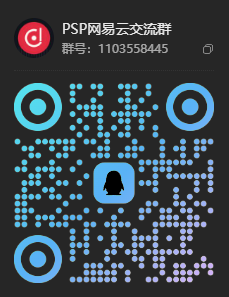

# PSP 网易云第一个版本，总算做出来了

今天是 11 月 6 日，周五。我的 PSP 网易云，总算把第一个版本整出来了。

说真的，这一路花了不少钱。粗略算下来，至少也有六七百块了。钱是一回事，搭进去的时间又是另一回事。折腾到后来，真的有点不想干了。

光是这几天研究硬件解码，就耗掉了我大量的时间。前前后后写了二三十个测试程序，最后得到的成绩却是：**59 秒，解码 2 帧。**

看着这个结果，实在有点泄气。

不过，折腾到最后，我也算找到了接下来该主攻的方向。MV 解码没那么重要，没必要一直卡在这里。先把软件做出来，后面再慢慢更新吧。

于是，我先去做了公告系统、更新系统，又把软件里的一些小问题修修补补。总算赶在这个周五，做出了第一个成品。

也算是成功了吧。

当然，软件的问题还是很多，离做好还差得远。但我估计，接下来不能再花这么多时间在它上面了。明年还有更主要的事情要做，总得给自己留点时间和精力。

先把这个版本做出来，剩下的，就慢慢来吧。

---

如果你也对这个项目感兴趣，欢迎加入 **PSP网易云交流群**，一起交流。

群号：**1103558445**

